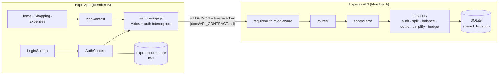
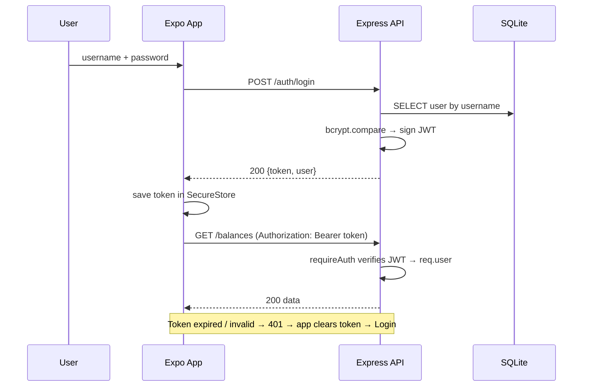
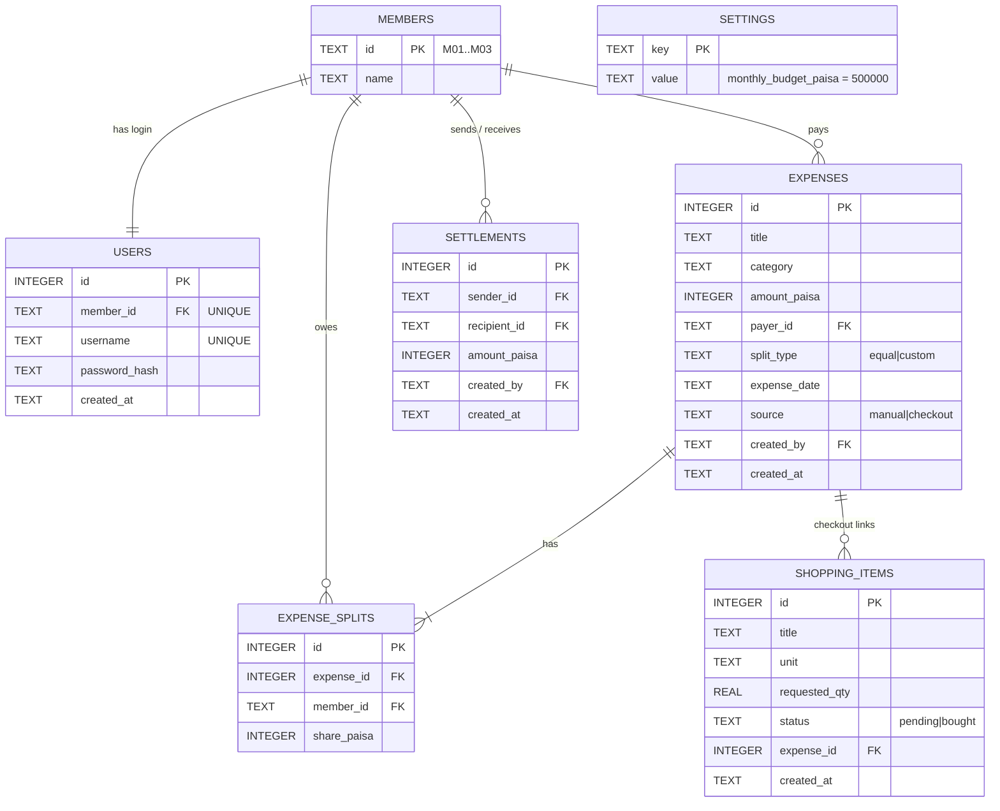

# Shared Living App — Architecture & Requirements

> **Status:** FROZEN after the setup commit (Zone S). Change rules: `OWNERSHIP.md`.
> **Contract:** `docs/API_CONTRACT.md` is the single source of truth between frontend and backend.
> **Packages:** `PACKAGES.md` · **Work split & timeline:** `TASKS.md`

---

## 0. How to Read This Document

Every requirement has an ID (`AREA-NN`), a level, and an owner.

| Level | Meaning |
|---|---|
| **MUST** | Required. Missing it = incomplete build / lost marks |
| **SHOULD** | Expected for a polished result; do it after all MUSTs |
| **MAY** | Stretch; only if time remains |

Owner: **A** = Member A (backend zone) · **B** = Member B (frontend zone) · **A+B** = both sides, defined by the contract.

---

## 1. Scope & Goals

| Item | Decision |
|---|---|
| Product | Roommates track shopping, shared expenses, balances, settlements, monthly budget — behind a login |
| Currency | PKR, exactly 2 decimal places, no floating-point money math |
| Time box | 5 hours (surprise requirement released at Hour 3.5) |
| Team | 2 members, strict zone ownership |
| Frontend | React Native (Expo), React Navigation bottom tabs |
| Backend | Node.js + Express |
| Database | SQLite via `better-sqlite3` |
| Authentication | Username + password → signed JWT (bcrypt-hashed passwords) |
| Hard invariant | Σ of all member net balances = **exactly 0.00** at all times |

### 1.1 Authentication vs. the official task sheet
The official RC3 sheet does **not** list authentication. Auth is therefore an *additional* layer and must **never break a sheet requirement**:
1. The Home **member selector (Ali / Ayesha / Bilal) stays** and works exactly as specified. After login it defaults to the logged-in member, but may switch the *viewed* member (read-only view).
2. All official endpoints keep their exact paths, payloads and outputs. Auth only adds a header and new `/auth/*` endpoints.
3. `AUTH_REQUIRED=false` (env, backend) disables token checks so judges/tools can hit endpoints directly if asked (AUTH-14).
4. Seeded demo accounts exist so login never delays the 5-minute demo.

---

## 2. System Architecture



**Integration boundary:** the only thing the two halves share is the HTTP contract. Neither side imports code from the other.

---

## 3. Repository Layout (with owners)

```
shared-living-app/
├── ARCHITECTURE.md · OWNERSHIP.md · TASKS.md · PACKAGES.md · AGENTS.md · README.md   [S] frozen
├── docs/API_CONTRACT.md            [S*] A edits ONLY after B approves (OWNERSHIP R4)
├── scripts/check-ownership.js      [S]   .githooks/pre-commit  [S]
│
├── backend/                        [A]
│   ├── package.json · .env.example
│   ├── server.js                   bootstrap, CORS, JSON, mount /api, error middleware, listen 0.0.0.0
│   ├── database.js                 connection, schema, idempotent seed (members, users, budget)
│   ├── routes/
│   │   ├── index.js                mounts routers; applies requireAuth to everything except public routes
│   │   ├── auth.routes.js          POST /auth/login · GET /auth/me
│   │   ├── members.routes.js · shopping.routes.js · expenses.routes.js
│   │   └── balances.routes.js · settle.routes.js · budget.routes.js
│   ├── controllers/                HTTP only: parse → call service → shape response
│   ├── services/                   ALL business logic
│   │   ├── authService.js          verifyCredentials, signToken, verifyToken
│   │   ├── money.js · splitEngine.js · balanceService.js · settlementService.js
│   │   ├── simplifyService.js · expenseService.js · shoppingService.js · budgetService.js
│   ├── middleware/
│   │   ├── requireAuth.js          JWT check → req.user
│   │   ├── loginRateLimit.js       in-memory brute-force guard
│   │   ├── validate.js · errorHandler.js
│   ├── utils/AppError.js · utils/resetDb.js
│   └── data/                       SQLite file (gitignored)
│
├── tests/                          [A]  split.test.js · benchmark.test.js · auth.test.js
│
└── frontend/                       [B]
    ├── App.js                      providers + auth-gated navigation (Login stack ⇄ Tabs)
    ├── .env.example                EXPO_PUBLIC_API_URL
    ├── screens/  LoginScreen.jsx · HomeScreen.jsx · ShoppingScreen.jsx · ExpensesScreen.jsx
    ├── components/                 Card · MoneyText · StatusBadge · ProgressBar · PrimaryButton ·
    │                               MemberSelector · ErrorBanner · LoadingOverlay · AddItemForm ·
    │                               CheckoutModal · ExpenseForm · SettleModal · BalanceTable · SmartSettleCard
    ├── context/  AuthContext.jsx · AppContext.jsx
    ├── hooks/useAsyncAction.js
    ├── services/  api.js · tokenStorage.js
    ├── utils/format.js · theme.js
```

---

## 4. Requirements by Area

### 4.1 General & Non-Functional (GEN)
| ID | Requirement | Level | Owner |
|---|---|---|---|
| GEN-01 | All money is PKR with ≤ 2 decimals; backend does arithmetic in **integer paisa** only | MUST | A |
| GEN-02 | Σ net balances = 0.00 after every operation; backend asserts and logs on violation | MUST | A |
| GEN-03 | Data survives backend restart and app restart (no authoritative client data except the token) | MUST | A+B |
| GEN-04 | No cross-zone imports; frontend ↔ backend communicate over HTTP only | MUST | A+B |
| GEN-05 | No secrets, `.env`, tokens or DB files committed; `.env.example` documents every variable | MUST | A+B |
| GEN-06 | Each member can explain every file in their own zone (oral defense) | MUST | A+B |
| GEN-07 | Local API responses feel instant (< 300 ms typical) | SHOULD | A |
| GEN-08 | One-line request log (`METHOD path status ms`); stack traces only for 5xx | SHOULD | A |

### 4.2 Database (DB)
| ID | Requirement | Level | Owner |
|---|---|---|---|
| DB-01 | SQLite file at `backend/data/shared_living.db`, created automatically on first start | MUST | A |
| DB-02 | Tables: `members`, `users`, `shopping_items`, `expenses`, `expense_splits`, `settlements`, `settings` | MUST | A |
| DB-03 | Money columns are `INTEGER` paisa with `CHECK(amount_paisa > 0)`, `CHECK(share_paisa >= 0)`, `CHECK(sender_id <> recipient_id)` | MUST | A |
| DB-04 | `PRAGMA foreign_keys = ON`; every FK declared | MUST | A |
| DB-05 | Idempotent seed: M01 Ali, M02 Ayesha, M03 Bilal; budget 500000 paisa; 3 user accounts (see AUTH-02). Re-running never duplicates | MUST | A |
| DB-06 | Every multi-table write (checkout, expense+splits) runs in one transaction | MUST | A |
| DB-07 | `expenses` and `settlements` store `created_by` (member ID of the authenticated user) | MUST | A |
| DB-08 | `npm run db:reset` deletes and re-seeds the DB for demo rehearsal | SHOULD | A |

### 4.3 Authentication & Authorization — Backend (AUTH)
| ID | Requirement | Level | Owner |
|---|---|---|---|
| AUTH-01 | `users` table is 1:1 with members: `id`, `member_id` (UNIQUE FK), `username` (UNIQUE, stored lowercase), `password_hash`, `created_at` | MUST | A |
| AUTH-02 | Seed accounts `ali`, `ayesha`, `bilal` (→ M01/M02/M03) with password from env `SEED_PASSWORD` (demo default `Demo@1234`) | MUST | A |
| AUTH-03 | Passwords hashed with `bcryptjs` (cost 10). Plaintext is never stored, logged or returned | MUST | A |
| AUTH-04 | `POST /api/auth/login` `{username, password}` → `200 {token, expires_in, user}`; username match is case-insensitive | MUST | A |
| AUTH-05 | Bad username **and** bad password return the same `401 INVALID_CREDENTIALS` with the same message (no user enumeration) | MUST | A |
| AUTH-06 | Token = JWT, HS256, claims `sub` (user id), `member_id`, `username`, `iat`, `exp`; lifetime from env `JWT_EXPIRES_IN` (default `12h`) | MUST | A |
| AUTH-07 | `JWT_SECRET` comes from env; server **refuses to start** if it is missing/empty | MUST | A |
| AUTH-08 | `requireAuth` protects every `/api` route except `GET /health` and `POST /auth/login`; missing, malformed, bad-signature or expired token → `401 UNAUTHORIZED` | MUST | A |
| AUTH-09 | `GET /api/auth/me` returns the current user and member `{id, username, member_id, name}` | MUST | A |
| AUTH-10 | `POST /settle` requires the authenticated member to be the **sender or recipient**; otherwise `403 FORBIDDEN` | MUST | A |
| AUTH-11 | `created_by` is taken from the token, **never** from the request body | MUST | A |
| AUTH-12 | Login rate limit: ≥ 5 failed attempts per username+IP within 60 s → `429 TOO_MANY_ATTEMPTS` (in-memory, no extra package) | SHOULD | A |
| AUTH-13 | `POST /auth/change-password` `{current_password, new_password}` (min 8 chars) | MAY | A |
| AUTH-14 | Env `AUTH_REQUIRED` (default `true`). When `false`, `requireAuth` is a pass-through, and the AUTH-10 check is skipped. Documented as a testing switch only | SHOULD | A |
| AUTH-15 | CORS allows the `Authorization` header | MUST | A |

### 4.4 Authentication — Frontend (AUTHFE)
| ID | Requirement | Level | Owner |
|---|---|---|---|
| AUTHFE-01 | `LoginScreen`: username, password (show/hide toggle), submit button with spinner, disabled while loading, error banner on failure | MUST | B |
| AUTHFE-02 | JWT persisted with **`expo-secure-store`** (key `auth_token`) via `services/tokenStorage.js`; never AsyncStorage or logs | MUST | B |
| AUTHFE-03 | `AuthContext` exposes `status` (`loading` \| `signedOut` \| `signedIn`), `user`, `login()`, `logout()` | MUST | B |
| AUTHFE-04 | App start: read token → `GET /auth/me`; success → tabs, failure → Login; splash/loader while `status = loading` | MUST | B |
| AUTHFE-05 | Navigation guard in `App.js`: Login when signed out, Tabs when signed in (conditional render; no way to reach tabs signed out) | MUST | B |
| AUTHFE-06 | Axios **request** interceptor adds `Authorization: Bearer <token>` | MUST | B |
| AUTHFE-07 | Axios **response** interceptor: `401` on any non-login call → clear token, return to Login, banner "Session expired. Please log in again." | MUST | B |
| AUTHFE-08 | Logout button (Home header) clears token and all context state | MUST | B |
| AUTHFE-09 | After login, active member = logged-in member; selector still lets the user **view** other members' balance (sheet requirement) | MUST | B |
| AUTHFE-10 | Forms default `payer` / `sender` to the logged-in member | SHOULD | B |
| AUTHFE-11 | Settle / One-Tap Settle: enabled only where logged-in member is sender or recipient; otherwise disabled with hint "Only the people involved can record this payment" (server enforces anyway, AUTH-10) | SHOULD | B |
| AUTHFE-12 | Login screen shows demo-account hint (`ali / ayesha / bilal`) only in `__DEV__` builds | MAY | B |

### 4.5 Backend REST API (API)
| ID | Requirement | Level | Owner |
|---|---|---|---|
| API-01 | Implement every endpoint in `docs/API_CONTRACT.md` with exact paths, payloads, status codes | MUST | A |
| API-02 | Required by the sheet: `GET /members`, `GET+POST /shopping`, `POST /shopping/checkout`, `POST /expenses`, `GET /balances`, `POST /settle`; plus `GET /balances/simplify` (Annexure Option 1) | MUST | A |
| API-03 | Additions: `/auth/*`, `GET /expenses`, `GET /budget`, `GET /health` | MUST | A |
| API-04 | Layering: routes → controllers → services → database. No SQL in controllers; no `req/res` in services | MUST | A |
| API-05 | Server-side validation of every field (types, enums, ranges, ≤ 2 decimals, existence); errors use the contract envelope | MUST | A |
| API-06 | Unknown errors → `500 INTERNAL_ERROR` with a generic message; details only in server log | MUST | A |
| API-07 | Binds `0.0.0.0:3000` (phone-reachable); JSON body limit 100 kb | MUST | A |

### 4.6 Financial Engine (FIN)
| ID | Requirement | Level | Owner |
|---|---|---|---|
| FIN-01 | Equal split: `base = floor(total/n)`, `rem = total % n`; first `rem` members in **ascending member ID** get +1 paisa | MUST | A |
| FIN-02 | Rounding check: 1,000.00 over M01/M02/M03 → **333.34 / 333.33 / 333.33** | MUST | A |
| FIN-03 | Custom split: Σ split amounts must equal the expense amount in paisa, else `400 SPLIT_MISMATCH` | MUST | A |
| FIN-04 | Net balance = paid − share owed + settlements received − settlements sent | MUST | A |
| FIN-05 | Settlement validation, in order: amount > 0 → sender ≠ recipient → both exist → sender is a debtor & recipient a creditor → amount ≤ min(debt, credit) → (AUTH-10) caller is a party | MUST | A |
| FIN-06 | Settlements never change household spending | MUST | A |
| FIN-07 | Checkout is atomic: marks items `bought`, creates a Groceries equal-split expense dated today; repeat checkout of a bought item → `409 ALREADY_BOUGHT` | MUST | A |
| FIN-08 | Payer and every split member must exist; at least one split member; `total_paid`/`amount` > 0 | MUST | A |
| FIN-09 | `GET /balances/simplify`: greedy largest-debtor ↔ largest-creditor, ties by member ID ascending; empty list when settled | MUST | A |
| FIN-10 | Benchmark (§8) passes exactly | MUST | A |

### 4.7 Budget (BUD)
| ID | Requirement | Level | Owner |
|---|---|---|---|
| BUD-01 | Monthly household budget = `settings.monthly_budget_paisa` (5,000.00) | MUST | A |
| BUD-02 | `spent` = Σ expenses whose `expense_date` is in the current calendar month | MUST | A |
| BUD-03 | `remaining = budget − spent` (may be negative); `percent_used` rounded to 1 decimal | MUST | A |
| BUD-04 | Status: `< 80%` → `on_track` · `80% to < 100%` → `near_limit` · `≥ 100%` → `over_budget` (benchmark 84% = Near Limit) | MUST | A |

### 4.8 Frontend Structure & State (FE)
| ID | Requirement | Level | Owner |
|---|---|---|---|
| FE-01 | Bottom tab navigator: **Home · Shopping · Expenses**, visible only when signed in | MUST | B |
| FE-02 | Modals (Checkout, Add Expense, Settle Up) are reusable components, not screens | MUST | B |
| FE-03 | `AppContext`: `members`, `activeMemberId`, `refreshKey`; successful writes call `bumpRefresh()`; screens refetch on change | MUST | B |
| FE-04 | Backend is the source of truth: **no client-side balance/split math** | MUST | B |
| FE-05 | `services/api.js`: one Axios instance (`EXPO_PUBLIC_API_URL`, 10 s timeout), one exported function per endpoint; screens never call Axios directly | MUST | B |
| FE-06 | Interceptor normalizes every failure to `{code, message, field?}`; network failure → `NETWORK_ERROR` "Cannot reach server. Check your connection." | MUST | B |
| FE-07 | `useAsyncAction` wrapper: `loading`, `error`, `run()`; `run()` is a no-op while loading | MUST | B |
| FE-08 | Reusable UI components contain no API calls | SHOULD | B |

### 4.9 Screens (SCR)
| ID | Requirement | Level | Owner |
|---|---|---|---|
| HOME-01 | Current-month spend and monthly budget with a progress bar (green `on_track`, amber `near_limit`, red `over_budget`) | MUST | B |
| HOME-02 | Active member selector (Ali / Ayesha / Bilal) | MUST | B |
| HOME-03 | Net-balance card for the active member: "You are owed PKR 250.00" / "You owe PKR 450.00" / "You are all settled up" | MUST | B |
| HOME-04 | Count of remaining pending shopping items | MUST | B |
| HOME-05 | Header shows logged-in user's name and a Logout button | MUST | B |
| SHOP-01 | Item list with status tags (Pending / Bought) | MUST | B |
| SHOP-02 | Add-item form: title, unit (pack / dozen / bottle / bag chips), requested quantity; client-side required checks | MUST | B |
| SHOP-03 | Multi-select pending items → Checkout modal: total price, payer, split members (default all) → submit via API | MUST | B |
| SHOP-04 | Bought items are not selectable; list refreshes after checkout | MUST | B |
| EXP-01 | Manual expense form: title, category, date (`YYYY-MM-DD`, default today), amount, payer, split strategy (Equal / Custom; custom shows one amount field per member) | MUST | B |
| EXP-02 | Live member balance table (paid, owed, net; green positive, red negative) | MUST | B |
| EXP-03 | **Settle Up** modal: sender, recipient, amount; server errors (over-settlement, 403, etc.) shown in banner | MUST | B |
| EXP-04 | **Smart Settle Suggestions** button → cards "Ayesha pays Ali PKR 250.00" with **One-Tap Settle** (uses `POST /settle`) | MUST | B |
| EXP-05 | Recent-expenses list below the form | SHOULD | B |

### 4.10 UX, Resilience & Design (UX)
| ID | Requirement | Level | Owner |
|---|---|---|---|
| UX-01 | Loading indicator for every async fetch and submit | MUST | B |
| UX-02 | Submit buttons disabled while checkout / expense / settle / login requests are in flight (no double submission) | MUST | B |
| UX-03 | Error banners/toasts for validation errors **and** network drops; dismissible, auto-hide | MUST | B |
| UX-04 | Empty states ("No items yet"), pull-to-refresh on lists | SHOULD | B |
| DES-01 | One `theme.js` (colors, spacing, typography); consistent spacing and card layout | MUST | B |
| DES-02 | Every amount rendered via `formatPKR()` → `PKR 1,234.50` | MUST | B |
| DES-03 | Touch targets ≥ 44 px, readable contrast, clear visual hierarchy | SHOULD | B |

### 4.11 Integration (INT)
| ID | Requirement | Level | Owner |
|---|---|---|---|
| INT-01 | Frontend implements the contract exactly; backend never returns fields the contract doesn't list | MUST | A+B |
| INT-02 | Contract changes only via OWNERSHIP R4 (request → "APPROVED" → Member A edits) | MUST | A+B |
| INT-03 | Frontend base URL from `EXPO_PUBLIC_API_URL`; phone and laptop on the same Wi-Fi | MUST | B |
| INT-04 | Error `code` values are handled by `code`, never by parsing message text | SHOULD | B |

### 4.12 Testing (TEST)
| ID | Requirement | Level | Owner |
|---|---|---|---|
| TEST-01 | `tests/split.test.js`: 1,000 → 333.34 / 333.33 / 333.33; custom mismatch; remainder > 1 paisa | MUST | A |
| TEST-02 | `tests/benchmark.test.js`: full 4,200 scenario, balances, budget 84%, simplify, both settlements | MUST | A |
| TEST-03 | `tests/auth.test.js`: login OK, wrong password, unknown user (same error), no token → 401, expired/garbage token → 401, settle by non-party → 403 | MUST | A |
| TEST-04 | Run with Node's built-in runner: `npm test` (no extra framework) | MUST | A |
| TEST-05 | Manual on-device run of the demo script (`TASKS.md` §6) at Hour 3.5 and Hour 4.5 | MUST | A+B |

### 4.13 Surprise-Round Readiness (SUR)
| ID | Requirement | Level | Owner |
|---|---|---|---|
| SUR-01 | Option 1 (Smart Settle) is built before Hour 3.5 (cheap, "recommended") | MUST | A+B |
| SUR-02 | Whatever option is released: contract delta posted within 5 min → approved → both sides build in parallel; all existing features and auth keep working | MUST | A+B |
| SUR-03 | New endpoints sit behind `requireAuth` like all others | MUST | A |

---

## 5. Authentication Design

### 5.1 Login & request flow


### 5.2 Endpoint protection
| Endpoint | Auth | Extra rule |
|---|---|---|
| `GET /health`, `POST /auth/login` | public | login is rate-limited (AUTH-12) |
| `GET /auth/me` | token | — |
| `GET /members`, `GET /shopping`, `GET /expenses`, `GET /balances`, `GET /balances/simplify`, `GET /budget` | token | any household member may read the shared ledger |
| `POST /shopping`, `POST /shopping/checkout`, `POST /expenses` | token | any member; `payer_id` may be any member; `created_by` = token member |
| `POST /settle` | token | caller must be **sender or recipient** (403 otherwise) |

### 5.3 Frontend session lifecycle
`App start → status=loading → read token → GET /auth/me → signedIn | signedOut` · `login() → store token → status=signedIn` · `logout() or 401 → delete token → status=signedOut`.

### 5.4 Security checklist
- [ ] Passwords only as bcrypt hashes; never logged/returned
- [ ] `JWT_SECRET` in `backend/.env` only; app refuses to boot without it
- [ ] Same error for unknown user and wrong password
- [ ] Token only in SecureStore; never in logs or URLs
- [ ] `created_by` / identity always from the token, never the request body
- [ ] Rate limit on login

### 5.5 Known limitations (state them honestly in the demo if asked)
- Traffic is plain HTTP on the local network (HTTPS is out of scope for a LAN demo).
- Stateless JWT cannot be revoked before expiry; logout is client-side token deletion.
- Demo accounts share a known seed password; change `SEED_PASSWORD` for anything beyond the demo.

---

## 6. Data Model



---

## 7. Algorithms (reference for FIN-01 … FIN-09)

**Equal split (integer paisa)**
```
total = toPaisa(amount); n = members.length
base  = floor(total / n); rem = total % n
sort member IDs ascending
share[i] = base + (i < rem ? 1 : 0)
```
`100000 / 3 → base 33333, rem 1` → M01 `333.34`, M02 `333.33`, M03 `333.33`. ✔

**Net balance:** `net = paid − owed + received − sent` using `SUM` queries per member; assert `Σ net = 0`.

**Smart Settle (greedy):** debtors and creditors sorted descending by amount (ties: member ID ascending); repeatedly move `min(debt, credit)` from largest debtor to largest creditor until all are zero.

**Money helpers:** `toPaisa(x) = Math.round(x * 100)` once at the API boundary (reject > 2 decimals first); `fromPaisa(p) = p / 100`.

---

## 8. Acceptance Test (Benchmark + Auth)

Start from an empty ledger (`npm run db:reset`).

| # | Action | Expected |
|---|---|---|
| 0a | `POST /auth/login` as `ayesha` (correct password) | 200, token, `member_id: "M02"` |
| 0b | Same with wrong password / unknown user | 401 `INVALID_CREDENTIALS`, identical message |
| 0c | `GET /balances` without token | 401 `UNAUTHORIZED` |
| 1 | Grocery 780 paid by M01, equal ×3 | 260 / 260 / 260; spend 780 |
| 2 | Cleaning 900 paid by M02, equal M01+M02 | 450 / 450; spend 1,680 |
| 3 | Internet 1,500 paid by M03, custom 500 / 300 / 700 | spend 3,180 |
| 4 | Electricity 1,020 paid by M01, equal ×3 | 340 each; spend 4,200 |
| 5 | `GET /balances` | M01 +250.00 · M02 −450.00 · M03 +200.00 · **sum 0.00** |
| 6 | `GET /budget` | spent 4,200 · remaining 800 · 84% · `near_limit` |
| 7 | `GET /balances/simplify` | M02→M01 250.00, M02→M03 200.00 |
| 8 | Logged in as **Bilal**, settle M02→M01 250 | 403 `FORBIDDEN` (not a party) |
| 9 | Logged in as **Ayesha**, settle M02→M01 250, then M02→M03 200 | all nets 0.00; spend still 4,200 |
| 10 | Split 1,000 ×3 | 333.34 / 333.33 / 333.33 |
| 11 | Settle 0, −5, M01→M01, M02→M01 9999 | rejected: `NON_POSITIVE_AMOUNT`, `NON_POSITIVE_AMOUNT`, `SELF_PAYMENT`, `OVER_SETTLEMENT` |
| 12 | Restart backend, then restart app | Data intact; app resumes session or shows Login if token expired |

---

## 9. Rubric Traceability

| Rubric | Marks | Covered by |
|---|---|---|
| Functionality | 50 | API-*, FIN-*, BUD-*, SHOP-*, EXP-*, SUR-*, DB-* |
| Design | 20 | HOME-*, SHOP-*, EXP-*, FE-01/02, DES-*, AUTHFE-01 |
| Code Quality | 10 | API-04, FE-03…FE-08, §3 layout, AUTH layering |
| UX & Verification | 20 | UX-*, AUTH-05/10/12, AUTHFE-07/11, GEN-06, TEST-* |

---

## 10. Definition of Done
- [ ] Every MUST requirement above is implemented by its owner
- [ ] §8 acceptance table passes, from the mobile UI where applicable
- [ ] Login, session restore, 401 handling and logout work on a real device
- [ ] Backend restart and app restart both keep all data
- [ ] Loading indicators, disabled submit buttons and error banners on every write action
- [ ] `.env` files and secrets are not in git; `.env.example` is complete
- [ ] Each member can explain their zone, including how auth works end to end

